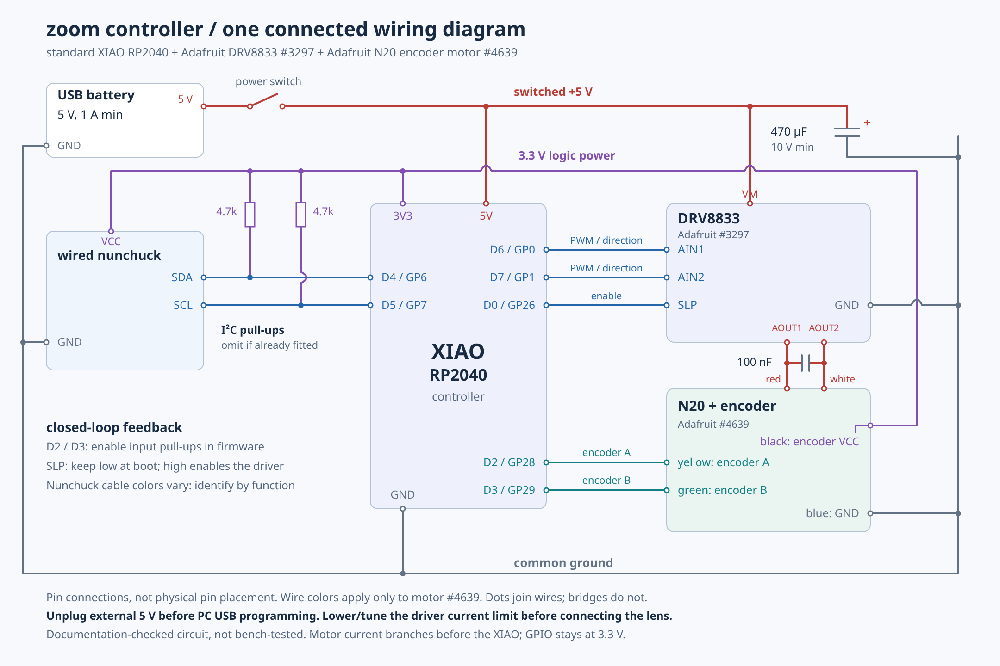

# zoom-ring

Research and implementation handoff for a compact, wired, encoder-controlled camera zoom attachment.

Current scope: motorized zoom only on an existing monopod. Printed pulleys and a purchased timing belt are the planned mechanical approach.

Status as of 2026-10-15: research and reference wiring, not a finished or bench-tested build. No hardware purchase, final motor selection, firmware implementation or CAD is recorded here.

## Start here

1. [Agent handoff](docs/HANDOFF.md): current state, reading order and next useful work.
2. [Requirements and decisions](docs/requirements-and-decisions.md): confirmed requirements versus recommendations.
3. [Electronics BOM and motor comparison](docs/electronics-bom.md).
4. [Wiring and electrical checks](docs/wiring.md).
5. [Open questions and validation](docs/open-questions-and-validation.md).

## Reference architecture

Wired Wii Nunchuck → standard Seeed XIAO RP2040 → Adafruit DRV8833 → geared DC motor → belt/pulleys → lens zoom ring.

A quadrature motor encoder feeds the XIAO for closed-loop speed control. A regulated 5 V USB supply feeds the XIAO and motor driver through separate parallel branches; logic and encoder power are 3.3 V.

The reference wiring is specific to Adafruit encoder motor #4639. Other motors require their own pinout, supply and current checks.

[Editable SVG](docs/diagrams/zoom-wiring-unified.svg) · [Browser version](docs/diagrams/zoom-wiring-unified.html) · [Connection netlist](docs/diagrams/zoom-wiring-netlist.json)

## Research library

- [Controls and firmware design](docs/controls-and-firmware.md)
- [Mechanical and power tradeoffs](docs/mechanics-and-power.md)
- [Temporary/solderless prototyping connections](docs/prototyping-connections.md)
- [Earlier stabilization, pan/tilt and used-gimbal research](docs/earlier-stabilization-research.md), historical/deferred scope
- [Dated research log and coverage](docs/research-log.md)
- [Sources and product links](docs/sources.md)
- [Diagram assets and regeneration](docs/diagrams/README.md)
- [Repository collaboration guidance](AGENTS.md)

## Use on a Mac

Clone this repository, then give your agent this instruction:

> Read AGENTS.md, README.md and docs/HANDOFF.md. Summarize the current zoom-only design, distinguish confirmed requirements from candidate parts, and identify the next measurements needed before motor/gearing selection. Do not assume anything has been purchased or physically tested.

Each agent/machine should use a separate checkout. Keep updates small and source-backed.

Prices and stock notes are historical observations, not current offers. This handoff contains curated technical research, not private chat transcripts or account credentials.
